# m16khb

백엔드와 인프라, 개발을 돕는 에이전트 도구를 만듭니다. 
한국어로 일하고 기록하며, 테스트와 실제 실행으로 동작을 확인합니다.

[포트폴리오](https://m16khb.dev) · [m16khb-org](https://github.com/m16khb-org)

## 경력

| 기간 | 회사 | 주요 업무 |
| --- | --- | --- |
| 2023.05 ~ 현재 | (주)버블탭 · 백엔드팀 | 웹툰과 AI 캐릭터 채팅 백엔드 개발, 2026.04부터 AWS ECS → NCP NKS 이전과 인프라 운영 |
| 2022.06 ~ 2023.05 | 주식회사 페이콕 · 백엔드/개발팀 | 사설 NPM 저장소와 공통 라이브러리 구축, AWS ECS · Lambda 네트워크 설계 |

## 실무 프로젝트

| 서비스 | 소개 | 담당 |
| --- | --- | --- |
|  **버블챗** · [bubblechat.ai](https://bubblechat.ai) | (주)버블탭의 AI 캐릭터 채팅 서비스 | 백엔드 개발 · 인프라 운영 |
|  **팅글** · [tingle.chat](https://tingle.chat) | (주)버블탭의 AI 로맨스 채팅 서비스 | 백엔드 개발 · 인프라 운영 |

## 사이드 프로젝트

### 웹 서비스

| 서비스 | 소개 | 스택 |
| --- | --- | --- |
|  [루트챗](https://rootchat.me) | 대화 기록과 기억이 이어지는 AI 캐릭터 채팅 | Next.js · NestJS · pgvector · BullMQ |
|  [라이어 게임](https://liar.m16khb.dev) | 3~8명이 힌트와 투표로 라이어를 찾는 실시간 파티 게임 | Next.js · PostgreSQL · Valkey |
|  [모타](https://mota.m16khb.dev) · [GitHub](https://github.com/m16khb-org/mota) | 자주 타는 서울 버스 정류장의 도착 정보를 지도에서 확인하는 PWA | React · NestJS · Leaflet |
|  [몬티 홀 실험실](https://monty.m16khb.dev) | 문 개수를 바꿔 가며 몬티 홀 확률을 비교하는 인터랙티브 실험 | SvelteKit · Web Worker |

### 오픈소스

| 프로젝트 | 소개 | 스택 |
| --- | --- | --- |
| [issueops](https://github.com/m16khb-org/issueops) | Codex · Claude Code · Omo · omp가 이슈부터 PR/MR 정리까지 같은 실행 계약으로 일하게 하는 CLI/MCP 하네스 | Go · MCP · SQLite |
| [galpi](https://github.com/m16khb-org/galpi) · [소개](https://m16khb.dev/galpi/) | 녹음과 전사, 화자 분리를 내 기기 안에서 처리하는 macOS · Windows 회의록 앱 | Tauri · Rust |
| [herdr-agents-graph](https://github.com/m16khb-org/herdr-agents-graph) | 코딩 에이전트와 서브에이전트의 작업을 herdr 패널에 실시간 그래프로 보여 주는 플러그인 | Rust · ratatui |
| [herdr-powertoys](https://github.com/m16khb-org/herdr-powertoys) | herdr 분할 패널을 균등 분할하거나 1/2 · 2/3 · 1/3 비율로 맞추는 플러그인 | Perl |
| [claude-code](https://github.com/m16khb-org/claude-code-statusline) · [codex](https://github.com/m16khb-org/codex-statusline) · [omp](https://github.com/m16khb-org/omp-statusline) statusline | 모델과 Git · PR 정보, 컨텍스트와 사용량 게이지를 두 줄로 보여 주는 상태 표시줄 | Python · TypeScript |

## 기술 스택

- **백엔드** · TypeScript, NestJS, Go
- **앱** · React, Next.js, Tauri, Rust
- **인프라** · Docker, Kubernetes, AWS
- **데이터** · MySQL, PostgreSQL, Kafka

전체 기술 스택

| 분야 | 기술 |
| --- | --- |
| Backend & API | NestJS, Go, Gin, GORM, TypeScript, TypeORM, Swagger |
| App & Client | React, Next.js, SvelteKit, Vite, Tauri, Rust, Bun |
| Infra & Ops | Kubernetes, GitOps, Argo CD, n8n, Grafana |
| Data & Queue | MySQL, PostgreSQL, pgvector, Valkey, Drizzle, Elasticsearch, Kafka, BullMQ |
| Cloud & Automation | AWS, NCP, NKS, ECS, Docker, GitHub Actions |

